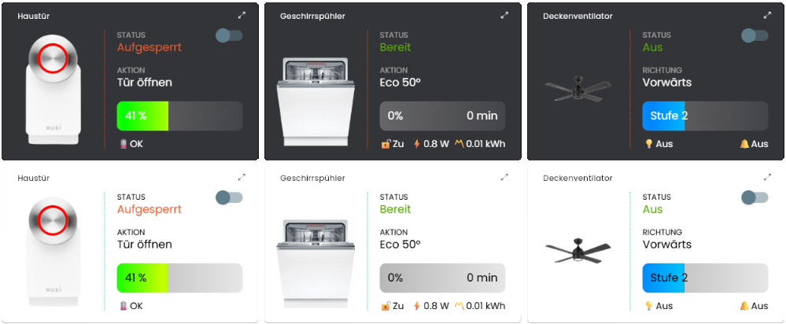

# 🎚️ Geräte-Widget (Device Widget)

Dieses Modul dient der Anzeige von Statusinformationen von Geräten als Kachel in der Tile Visualisierung.  
Ideal zur übersichtlichen Darstellung auf Dashboards.

## Inhaltsverzeichnis

1. [Funktionsumfang](#user-content-1-funktionsumfang)
2. [Voraussetzungen](#user-content-2-voraussetzungen)
3. [Installation](#user-content-3-installation)
4. [Einrichtung](#user-content-4-einrichtung)
5. [Statusvariablen](#user-content-5-statusvariablen)
6. [Darstellungen](#user-content-6-darstellungen)
7. [Visualisierung](#user-content-7-visualisierung)
8. [Befehlsreferenz](#user-content-8-befehlsreferenz)
9. [Versionshistorie](#user-content-9-versionshistorie)

### 1. Funktionsumfang

Durch Nutzung des HTML-SDKs kann dieses Widget Geräteinformationen und zusammenhängende Inhalte klar strukturiert und kachelfüllend darstellen. Neben rein textueller Darstellung unterstützt das Modul Bilder, Fortschrittsbalken und einen Ein/Aus-Schalter.

### 2. Voraussetzungen

* Symcon ab Version 8.1

### 3. Installation

* Über den Modul Store das Modul _Geräte-Widget_ installieren.
* Alternativ über das Modul Control folgende URL hinzufügen.  
`https://github.com/Wilkware/DeviceWidget` oder `git://github.com/Wilkware/DeviceWidget.git`

### 4. Einrichtung

* Unter 'Instanz hinzufügen' ist das _Geräte-Widget_-Modul unter dem Hersteller '(Geräte)' aufgeführt.
Weitere Informationen zum Hinzufügen von Instanzen in der [Dokumentation der Instanzen](https://www.symcon.de/service/dokumentation/konzepte/instanzen/#Instanz_hinzufügen)

__Konfigurationsseite__:

_Einstellungsbereich:_

> ⬛ Kachel ...

Name                                | Beschreibung
------------------------------------|--------------------------------------------
Hintergrundfarbe                    | Transparent oder beliebige Farbauswahl
Farbtransparenz                     | Durchsichtigkeit der gewählten Farbe von 0 bis 100%
Aufteilungsverhältnis               | Aufteilung Bild zu Informationen (von 20/80 bis 50/50)

> 🖼️ Bild ...

Name| Beschreibung
------------------------------------|--------------------------------------------
Statusbild (AN)                     | Bild für Status-Einträge mit der Zuordnung AN (siehe statusabhängige Darstellung)
Statusbild (AUS)                    | Bild für Status-Einträge mit der Zuordnung AUS sowie bei leerer Zuordnungstabelle

> 📴 Erreichbarkeit ...

Name                                | Beschreibung
------------------------------------|--------------------------------------------
Variable                            | Variable beliebigen Typs, die die Erreichbarkeit des Gerätes anzeigt (z. B. UNREACH, Online oder Status)
Online bei Wert                     | Wert der Variable, bei dem das Gerät erreichbar ist (z. B. true, 1 oder online) - jeder andere Wert gilt als offline
Badge-Farbe                         | Hintergrundfarbe des 'OFFLINE'-Badges

Ist das Gerät offline, wird oben rechts ein 'OFFLINE'-Badge angezeigt. Ein eingerichteter Schalter wird solange ausgeblendet. Ohne ausgewählte Variable entfällt die Funktion.

> 🎚️ Schalter ...

Name                                | Beschreibung
------------------------------------|--------------------------------------------
Variable                            | Statusvariable (An/Aus, Auf/Zu usw.), muss eine Aktion besitzen - ohne Aktion wird kein Schalter angezeigt
Typ                                 | Variablentyp (bool, int, float oder string)
Wert (AN)                           | Vergleichswert für Zustand AN, AUF oder AKTIV 
Wert (AUS)                          | Vergleichswert für Zustand AUS, ZU, INAKTIV

> ℹ️ Informationen ...

Status (1.Zeilenbereich)            | Beschreibung
------------------------------------|--------------------------------------------
Beschriftung                        | Überschrift/Label für Variablenwert
Variable                            | Variablenwert selbst
Schriftgröße                        | zu verwendende Schriftgröße in Pixel
Statusabhängige Darstellung         | Tabelle mit den ausgelesenen möglichen Variablenwerten (Profile) und entsprechenden Zuordnungen

Aktion (2.Zeilenbereich)            | Beschreibung
------------------------------------|--------------------------------------------
Beschriftung                        | Überschrift/Label für Variablenwert
Variable                            | Variablenwert selbst
Schriftgröße                        | zu verwendende Schriftgröße in Pixel

Fortschritt (3.Zeilenbereich)       | Beschreibung
------------------------------------|--------------------------------------------
Beschriftung                        | Überschrift/Label für Fortschrittsbalken
Variable                            | Variablenwert selbst
Schriftgröße                        | zu verwendende Schriftgröße in Pixel
Restlaufzeit                        | Möglichkeit zur Angabe einer Variablen mit Restlaufzeitinformationen (Sekunden oder HH:MM:SS)
Farbe (START)                       | Farbwert für Balkendarstellung (Start-Gradient)
Farbe (STOP)                        | Farbwert für Balkendarstellung (End-Gradient)

Zusätzliche Werte (4.Zeilenbereich) | Beschreibung (1. links, 2. mittig, 3. rechts)
------------------------------------|------------------------------------------------
Symbol                              | Icon für Info (bisherige Zeichen/Emojis werden weiterhin als Text angezeigt)
Präfix                              | Text vor Variablenwert
Variable                            | Variablenwert
Suffix                              | Text nach Variablenwert
Schriftgröße                        | zu verwendende Schriftgröße in Pixel

Existiert eine ausgewählte Variable oder ein ausgewähltes Medienobjekt nicht (mehr), wechselt die Instanz in den Status 201 (Fehler). Die übrigen Bereiche werden weiterhin angezeigt.

### 5. Statusvariablen

Es werden keine Statusvariablen angelegt.

### 6. Darstellungen

Es werden keine Darstellungen oder Profile benötigt.

### 7. Visualisierung

Das Modul kann direkt als Link in die TileVisu eingebunden werden.
Werte und Einstellungen werden bei Änderungen sofort in der Kachel aktualisiert, ohne dass sie neu geladen werden muss.

Die Kachel ist zweigeteilt (Aufteilungsverhältnis siehe Kachel-Einstellungen):

* __Links__: das statusabhängige Bild (AN oder AUS). Welches Bild angezeigt wird, legt die Spalte _Bild_ der statusabhängigen Darstellung fest.
* __Rechts__: bis zu vier Zeilenbereiche, nicht belegte Bereiche bleiben leer:
  1. __Status__: Beschriftung und formatierter Wert, Textfarbe gemäß statusabhängiger Darstellung
  2. __Aktion__: Beschriftung und formatierter Wert (z. B. aktuelles Programm)
  3. __Fortschritt__: Balken mit Farbverlauf (START → STOP), links der formatierte Wert, rechts die Restlaufzeit in Minuten
  4. __Zusatzinfos__: drei Werte mit Icon (links, mittig, rechts)
* __Oben rechts__: der Schalter (nur bei Variablen mit Aktion) oder, wenn das Gerät nicht erreichbar ist, das 'OFFLINE'-Badge.

__Statusabhängige Darstellung__

Beim Auswählen der Statusvariable wird die Tabelle aus deren Darstellung bzw. Profil befüllt. Je Wert lässt sich festlegen:

Spalte                              | Bedeutung
------------------------------------|--------------------------------------------
Fortschrittsbalken                  | Balken anzeigen; deaktiviert wird er auf 0 % / 0 min gesetzt (z. B. im Zustand 'Aus')
Farbe                               | Textfarbe des Statuswertes
Bild                                | Anzuzeigendes Statusbild (AN oder AUS)

Werte ohne Eintrag verwenden den Eintrag mit dem Wert 0. Ist die Tabelle leer, wird das AUS-Bild mit Fortschrittsbalken angezeigt.

__Fortschrittsbalken__

Der Wertebereich wird in folgender Reihenfolge ermittelt: Minimum/Maximum der Darstellung, Werte der Zuordnungen (Darstellung oder Profil), Minimum/Maximum des Profils, sonst 0 bis 100.
Bei ganzzahligen Bereichen ab 1 (z. B. Programmschritte 1..6) füllt bereits die erste Stufe 1/n des Balkens, alle anderen Bereiche werden linear berechnet.
Die Restlaufzeit kann in Sekunden oder als `HH:MM:SS` vorliegen.

### 8. Befehlsreferenz

Das Modul stellt keine direkten Funktionsaufrufe zur Verfügung.  

### 9. Versionshistorie

v1.2.20261002

* _NEU_: Offline-Badge über Erreichbarkeits-Variable (beliebiger Typ) mit Online-Wert und Badge-Farbe
* _NEU_: Unterstützung von Darstellungen (Symcon 8) für Fortschrittsbalken und statusabhängige Darstellung
* _NEU_: Fortschrittsbalken rechnet ganzzahlige Bereiche ab 1 stufig (erste Stufe = 1/n), alle anderen linear
* _NEU_: Bilder und Statuszuordnung werden mit dem Update übertragen, Änderungen wirken ohne Neuladen der Kachel
* _NEU_: Instanzstatus 201, wenn eine ausgewählte Variable oder ein Medienobjekt nicht existiert
* _NEU_: Initialisierung erst nach vollständigem Systemstart
* _NEU_: Schalter wird nur noch für Variablen mit Aktion angezeigt
* _NEU_: Symbole der Zusatzinfos über Icon-Auswahl (bisherige Zeichen/Emojis werden weiterhin angezeigt)
* _NEU_: Kachelränder werden aus der Visualisierung übernommen (dynamischer Kopfbereich)
* _NEU_: Skript der Kachel überarbeitet und strukturiert
* _FIX_: Warnung 'Cannot auto-convert value for parameter ID' bei Ermittlung von Min/Max behoben
* _FIX_: Fehlende Anzeige von Aktion, Fortschritt und Infos ohne konfigurierte Statusbilder behoben
* _FIX_: Fortschritt und Restlaufzeit mit Wert 0 werden jetzt angezeigt
* _FIX_: Fortschrittswert zur Laufzeit passt jetzt zum ermittelten Bereich
* _FIX_: Schriftgröße der dritten Zusatzinfo und Standard-Textfarbe des Status korrigiert
* _FIX_: Bilder mit Dateiendungen in Großbuchstaben werden jetzt erkannt
* _FIX_: Dokumentation überarbeitet

v1.1.20250916

* _NEU_: Projektumstrukturierung hin zu einer globalen CI/CD-Pipeline
* _FIX_: Fehler bei gleichem Wert für Min/Max für Fortschrittsbalken behoben
* _FIX_: Dokumentation überarbeitet

v1.0.20250729

* _NEU_: Initialversion

## Danksagung

Ich möchte mich für die großartige Idee und Vorarbeit zu diesem Modul bedanken bei ...

* _da8ter_ : für sein Vorbild-Modul __Geräte-Status Kachel__ 👍

Vielen Dank 🙏!

## Entwickler

Seit nunmehr über 10 Jahren fasziniert mich das Thema Haussteuerung. In den letzten Jahren betätige ich mich auch intensiv in der Symcon Community und steuere dort verschiedenste Skripte und Module bei. Ihr findet mich dort unter dem Namen @pitti ;-)

## Spenden

Die Software ist für die nicht kommerzielle Nutzung kostenlos, über eine Spende bei Gefallen des Moduls würde ich mich freuen.

## Lizenz

Namensnennung - Nicht-kommerziell - Weitergabe unter gleichen Bedingungen 4.0 International

